# Base de datos

Esquema de la base PostgreSQL que comparten todos los equipos, tal como lo crean las migraciones
de EF Core (`src/QuickInventory.Data/Migrations`) a partir de `BaseDbContext`.
Si cambias un modelo, añade una migración y actualiza también este documento.

Para ver el esquema real en cualquier momento: `dotnet ef migrations script --project src/QuickInventory.Data --startup-project src/QuickInventory.Data`,
o conectarse con `psql` o cualquier cliente de PostgreSQL (pgAdmin, DBeaver...).

## Diagrama

```mermaid
erDiagram
    Products ||--o{ SaleLines : "se vende en"
    Sales ||--|{ SaleLines : "tiene"
    Products ||--o{ StockMovements : "cambios de stock"
    Sales |o--o{ StockMovements : "origina"
    CashMovements ||--o| InvoiceFiles : "factura adjunta"
    Providers ||--o{ PurchaseInvoices : "nos factura"
    PurchaseInvoices ||--|{ PurchaseInvoiceLines : "tiene"
    Products |o--o{ PurchaseInvoiceLines : "se compra en"
    PurchaseInvoices |o--o{ StockMovements : "origina"
    PurchaseInvoices ||--|| InvoiceFiles : "archivo"

    Products {
        integer Id PK
        varchar Name "obligatorio, con índice"
        varchar Type "Ticket | Shop (discriminador)"
        varchar BarCode "solo Shop; opcional, con índice"
        bigint SalePrice "céntimos"
        bigint CostPrice "solo Shop; céntimos"
        integer Stock "solo Shop; solo cambia con StockMovements"
        integer MinStock "solo Shop"
        integer CountsAs "solo Ticket; unidades en el recuento"
        boolean Active "nunca se borra"
        timestamp RegistrationDate
    }

    Sales {
        integer Id PK
        timestamp Date "con índice"
        text SalesPoint "TicketOffice | Shop (discriminador)"
        text PaymentMethod "Cash | Card | BankTransfer"
        bigint Total "céntimos"
        boolean Canceled
        boolean GuidedVisit "solo TicketOffice"
        boolean GroupVisit "solo TicketOffice"
    }

    SaleLines {
        integer Id PK
        integer SaleId FK
        integer ProductId FK
        text Description "copia del nombre"
        integer Amount "unidades vendidas"
        bigint BasePrice "céntimos, copia sin descuento"
        bigint UnitPrice "céntimos, precio cobrado"
        text DiscountName "copia, opcional"
        bigint DiscountPercent "en céntimos: 3000 = 30 %"
        integer CountsAs "copia de Products.CountsAs"
        text Category "copia: Ticket | Shop"
    }

    StockMovements {
        integer Id PK
        integer ProductId FK
        integer SaleId FK "opcional"
        integer PurchaseInvoiceId FK "opcional"
        integer Amount "+ entra, - sale"
        text Type "Input | Output | Sale | Cancelation | Purchase | PurchaseCancelation"
        text Description "opcional"
        timestamp Date "con índice"
    }

    CashMovements {
        integer Id PK
        timestamp Date "con índice"
        text Type "Income | Pay"
        text Category
        varchar Description "concepto"
        bigint Amount "céntimos, siempre positivo"
        text PaymentMethod
        text SalesPoint "caja de la que sale; null = sin caja"
        varchar Person "opcional"
        varchar InvoiceNumber "opcional"
        varchar InvoiceFileName "opcional; el archivo está en InvoiceFiles"
        text Notes "opcional"
        boolean Canceled
    }

    InvoiceFiles {
        integer Id PK
        integer CashMovementId FK "opcional, único"
        integer PurchaseInvoiceId FK "opcional, único; uno de los dos (check)"
        varchar FileName
        varchar ContentType
        bytea Content "PDF o imagen, máx. 10 MB"
    }

    Providers {
        integer Id PK
        varchar Nif "9 caracteres, normalizado, único"
        varchar LegalName "nombre o razón social"
        varchar Address "opcional"
        varchar Email "opcional"
        varchar PhoneNumber "opcional, tal como se escribe"
        varchar Notes "opcional"
        boolean Active "nunca se borra"
    }

    PurchaseInvoices {
        integer Id PK
        integer ProviderId FK
        varchar Number "nº del proveedor; único por proveedor entre las no anuladas"
        date InvoiceDate "fecha de la factura; con índice"
        bigint BaseAmount "céntimos, suma de las líneas"
        bigint TaxAmount "céntimos, IVA calculado por tipo"
        bigint Amount "céntimos, base + IVA"
        date PaymentDate "null = pendiente de pago"
        text PaymentMethod "solo si está pagada"
        text PaymentSalesPoint "caja si se pagó en efectivo"
        varchar Notes "opcional"
        timestamp RegistrationDate "cuándo se apuntó"
        varchar InvoiceFileName "el archivo está en InvoiceFiles"
        boolean Canceled
    }

    PurchaseInvoiceLines {
        integer Id PK
        integer PurchaseInvoiceId FK
        integer ProductId FK "artículo de Tienda; null = línea libre"
        varchar Description "copia del nombre o texto libre"
        integer Quantity
        bigint UnitPrice "céntimos, sin IVA"
        text TaxRate "21 | 10 | 4 | 0"
    }

    Issuers {
        integer Id PK
        varchar Nif "9 caracteres, normalizado"
        varchar LegalName "nombre o razón social"
        varchar Address "opcional"
    }

    OnlineShopSettings {
        INTEGER Id PK "una sola fila"
        TEXT Url "dirección de PrestaShop"
        TEXT ApiKey "clave del Webservice (solo GET en orders)"
        TEXT TicketProductIds "ids separados por comas; vacío = todos"
        INTEGER DaysInAdvance "antelación máxima de compra"
    }
```

## Tablas

| Tabla                   | Modelo (`QuickInventory.Core/Models`)      | Para qué sirve                                                                                                                                  |
| ----------------------- | ------------------------------------------ | ----------------------------------------------------------------------------------------------------------------------------------------------- |
| `Products`              | `Product` (`TicketProduct`, `ShopProduct`) | Todo lo que se vende: entradas (Taquilla) y artículos (Tienda). Una sola tabla; `Type` dice cuál es y las columnas del otro tipo quedan a null. |
| `Sales`                 | `Sale`                                     | Una venta: fecha, punto de venta, método de pago y total.                                                                                       |
| `SaleLines`             | `SalesLine`                                | Cada producto de una venta, con nombre y precios **copiados** del momento de la venta.                                                          |
| `StockMovements`        | `StockMovement`                            | Historial de cada cambio de stock (ajustes, ventas, anulaciones).                                                                               |
| `CashMovements`         | `CashMovement`                             | Dinero que entra o sale y no es una venta ni una factura de proveedor. Preparada para Ingresos y Pagos; hoy la app no la usa (los antiguos reembolsos se quitaron). |
| `InvoiceFiles`          | `InvoiceFile`                              | Factura escaneada de un `CashMovement` o de una `PurchaseInvoice`. Tabla aparte para no cargar el archivo al listar.                            |
| `Providers`             | `Provider`                                 | Proveedores habituales, para elegirlos al apuntar sus facturas. No se borran (`Active`).                                                        |
| `PurchaseInvoices`      | `PurchaseInvoice`                          | Facturas que nos emiten los proveedores, siempre con su archivo. No se borran (`Canceled`).                                                     |
| `PurchaseInvoiceLines`  | `PurchaseInvoiceLine`                      | Lo que viene en cada factura de proveedor: artículos de Tienda (suman stock) o líneas libres. Cada línea tiene su IVA.                          |
| `OnlineShopSettings`    | `OnlineShopSettings`                       | Conexión con la tienda online (PrestaShop). Las entradas online (`OnlineTicket`) no se guardan: se leen de la tienda cada vez.                  |
| `Issuers`               | `Issuer`                                   | Titular del museo (quien emite las facturas). Una sola fila, creada por el asistente de primera instalación.                                    |
| `__EFMigrationsHistory` | —                                          | Migraciones aplicadas. La gestiona EF; la app solo la lee para comprobar la versión.                                                            |

## Relaciones

- **Sale → SaleLines (1 a muchos).** Una venta tiene al menos una línea (lo exige `SalesService`).
- **Product → SaleLines (1 a muchos).** La línea apunta al producto, pero no depende de él para
  mostrarse: nombre, precios, descuento, categoría y `CountsAs` están copiados, así que editar
  el producto no cambia el histórico.
- **Product → StockMovements (1 a muchos).** `Products.Stock` debe ser siempre la suma de sus movimientos.
- **Sale → StockMovements (0/1 a muchos).** Los movimientos de tipo `Sale` y `Cancelation` apuntan a
  la venta que los originó; los ajustes manuales no tienen venta.
- **CashMovement → InvoiceFile (1 a 0/1).** Índice único en `CashMovementId`.
- **PurchaseInvoice → InvoiceFile (1 a 1).** Índice único en `PurchaseInvoiceId`. La restricción
  `CK_InvoiceFiles_UnSoloDueno` obliga a que cada archivo tenga exactamente uno de los dos dueños.
- **PurchaseInvoice → PurchaseInvoiceLines (1 a muchos).** Al menos una línea. Los totales de la factura
  se guardan calculados: base = suma de las líneas; IVA = por tipo, sobre la suma de las bases de ese tipo.
- **Product → PurchaseInvoiceLines (0/1 a muchos).** Al apuntar la factura, cada línea de un artículo suma
  su cantidad al stock (movimiento `Purchase` con `PurchaseInvoiceId`) y su precio pasa a ser el `CostPrice`
  del producto. Al anularla se restan con movimientos `PurchaseCancelation`.
- **Provider → PurchaseInvoices (1 a muchos).** `Restrict`: un proveedor con facturas no se puede borrar
  (de todas formas, nunca se borran: se desactivan).
- `CashMovements.SalesPoint` y `PurchaseInvoices.PaymentSalesPoint` **no** son relaciones: son el enum de la
  caja (Taquilla/Tienda). Las facturas de proveedores pagadas en efectivo con una caja se restan al cerrarla
  el día del pago (`PaymentDate`).

## Convenciones de almacenamiento

- **Dinero:** todos los `decimal` se guardan como **céntimos enteros** (`AmountInCentsConverter`).
  `12,50 €` → `1250`. Ojo: `DiscountPercent` también es `decimal`, así que `30 %` se guarda como `3000`.
- **Enums:** como texto (`"Cash"`, `"TicketOffice"`...). `ProductCategory` se guarda por su `Value`
  (`"Ticket"`, `"Shop"`).
- **Fechas:** `timestamp without time zone`, con la hora local del museo (`DateTime.Now`).
  Es una convención de `BaseDbContext.ConfigureConventions`.
  Excepción: `PurchaseInvoices.InvoiceDate` y `PaymentDate` son `date` (sin hora), porque son el día
  que pone la factura y el día del pago.
- **Herencia:** una tabla por jerarquía. `Products.Type` y `Sales.SalesPoint` dicen la clase; las
  columnas de una sola clase (`Stock`, `CountsAs`, `GuidedVisit`...) son null en las filas de la otra.
- **Ids:** columnas `identity` de PostgreSQL.
- **Nada se borra:** productos y proveedores (`Active`), ventas y facturas de proveedores (`Canceled`) se marcan,
  para conservar el historial.
