# Base de datos

Esquema de la base PostgreSQL que comparten todos los equipos, tal como lo crean las migraciones
de EF Core (`src/QuickInventory.Data/Migrations`) a partir de `BaseDbContext`.
Si cambias un modelo, añade una migración y actualiza también este documento.

Para ver el esquema real en cualquier momento: `dotnet ef migrations script --project src/QuickInventory.Data --startup-project src/QuickInventory.Data`,
o conectarse con `psql` o cualquier cliente de PostgreSQL (pgAdmin, DBeaver...).

## Diagrama

```mermaid
erDiagram
    Products ||--o{ SaleLines : "se vende en"
    Sales ||--|{ SaleLines : "tiene"
    Products ||--o{ StockMovements : "cambios de stock"
    Sales |o--o{ StockMovements : "origina"
    CashMovements ||--o| InvoiceFiles : "factura adjunta"
    Providers ||--o{ PurchaseInvoices : "nos factura"
    PurchaseInvoices ||--|{ PurchaseInvoiceLines : "tiene"
    Products |o--o{ PurchaseInvoiceLines : "se compra en"
    PurchaseInvoices |o--o{ StockMovements : "origina"
    PurchaseInvoices ||--|| InvoiceFiles : "archivo"
    Providers ||--o{ DeliveryNotes : "nos entrega"
    DeliveryNotes ||--|{ DeliveryNoteLines : "tiene"
    Products |o--o{ DeliveryNoteLines : "llega en"
    DeliveryNotes |o--o{ StockMovements : "origina"
    DeliveryNotes ||--|| InvoiceFiles : "archivo"
    PurchaseInvoices |o--o{ DeliveryNotes : "incluye"
    DeliveryNotes |o--o{ PurchaseInvoiceLines : "copiadas en"
    Customers ||--o{ CustomerInvoices : "le facturamos"
    CustomerInvoices ||--|{ CustomerInvoiceLines : "tiene"
    Rooms |o--o{ CalendarEvents : "se reserva en"

    Products {
        integer Id PK
        varchar Name "obligatorio, con índice"
        varchar Type "Ticket | Shop (discriminador)"
        varchar BarCode "solo Shop; opcional, con índice"
        bigint SalePrice "céntimos"
        bigint CostPrice "solo Shop; céntimos"
        integer Stock "solo Shop; solo cambia con StockMovements"
        integer MinStock "solo Shop"
        integer CountsAs "solo Ticket; unidades en el recuento"
        boolean Active "nunca se borra"
        timestamp RegistrationDate
    }

    Sales {
        integer Id PK
        timestamp Date "con índice"
        text SalesPoint "TicketOffice | Shop (discriminador)"
        text PaymentMethod "Cash | Card | BankTransfer"
        bigint Total "céntimos"
        boolean Canceled
        boolean GuidedVisit "solo TicketOffice"
        boolean GroupVisit "solo TicketOffice"
    }

    SaleLines {
        integer Id PK
        integer SaleId FK
        integer ProductId FK
        text Description "copia del nombre"
        integer Amount "unidades vendidas"
        bigint BasePrice "céntimos, copia sin descuento"
        bigint UnitPrice "céntimos, precio cobrado"
        text DiscountName "copia, opcional"
        bigint DiscountPercent "en céntimos: 3000 = 30 %"
        integer CountsAs "copia de Products.CountsAs"
        text Category "copia: Ticket | Shop"
    }

    StockMovements {
        integer Id PK
        integer ProductId FK
        integer SaleId FK "opcional"
        integer PurchaseInvoiceId FK "opcional"
        integer DeliveryNoteId FK "opcional"
        integer Amount "+ entra, - sale"
        text Type "Input | Output | Sale | Cancelation | Purchase | PurchaseCancelation | DeliveryNote | DeliveryNoteCancelation"
        text Description "opcional"
        timestamp Date "con índice"
    }

    CashMovements {
        integer Id PK
        timestamp Date "con índice"
        text Type "Income | Pay"
        text Category
        varchar Description "concepto"
        bigint Amount "céntimos, siempre positivo"
        text PaymentMethod
        text SalesPoint "caja de la que sale; null = sin caja"
        varchar Person "opcional"
        varchar InvoiceNumber "opcional"
        varchar InvoiceFileName "opcional; el archivo está en InvoiceFiles"
        text Notes "opcional"
        boolean Canceled
    }

    InvoiceFiles {
        integer Id PK
        integer CashMovementId FK "opcional, único"
        integer PurchaseInvoiceId FK "opcional, único"
        integer DeliveryNoteId FK "opcional, único; uno solo de los tres (check)"
        varchar FileName
        varchar ContentType
        bytea Content "PDF o imagen, máx. 10 MB"
    }

    Providers {
        integer Id PK
        varchar Nif "9 caracteres, normalizado, único"
        varchar LegalName "nombre o razón social"
        varchar Address "opcional"
        varchar Email "opcional"
        varchar PhoneNumber "opcional, tal como se escribe"
        varchar Notes "opcional"
        boolean Active "nunca se borra"
    }

    PurchaseInvoices {
        integer Id PK
        integer ProviderId FK
        varchar Number "nº del proveedor; único por proveedor entre las no anuladas"
        date InvoiceDate "fecha de la factura; con índice"
        bigint BaseAmount "céntimos, suma de las líneas"
        bigint TaxAmount "céntimos, IVA calculado por tipo"
        bigint Amount "céntimos, base + IVA"
        date PaymentDate "null = pendiente de pago"
        text PaymentMethod "solo si está pagada"
        text PaymentSalesPoint "caja si se pagó en efectivo"
        varchar Notes "opcional"
        timestamp RegistrationDate "cuándo se apuntó"
        varchar InvoiceFileName "el archivo está en InvoiceFiles"
        boolean Canceled
    }

    PurchaseInvoiceLines {
        integer Id PK
        integer PurchaseInvoiceId FK
        integer ProductId FK "artículo de Tienda; null = línea libre"
        integer DeliveryNoteId FK "albarán del que se copió; no suma stock"
        varchar Description "copia del nombre o texto libre"
        integer Quantity
        bigint UnitPrice "céntimos, sin IVA"
        text TaxRate "21 | 10 | 4 | 0"
    }

    DeliveryNotes {
        integer Id PK
        integer ProviderId FK
        varchar Number "nº del proveedor; único por proveedor entre los no anulados"
        date DeliveryDate "fecha del albarán; con índice"
        bigint BaseAmount "céntimos; 0 si viene sin valorar"
        bigint TaxAmount "céntimos"
        bigint Amount "céntimos"
        integer PurchaseInvoiceId FK "factura que lo incluye; null = pendiente de facturar"
        varchar Notes "opcional"
        timestamp RegistrationDate "cuándo se apuntó"
        varchar FileName "el archivo está en InvoiceFiles"
        boolean Canceled
    }

    DeliveryNoteLines {
        integer Id PK
        integer DeliveryNoteId FK
        integer ProductId FK "artículo de Tienda; null = línea libre"
        varchar Description "copia del nombre o texto libre"
        integer Quantity
        bigint UnitPrice "céntimos, sin IVA; 0 si no viene"
        text TaxRate "21 | 10 | 4 | 0"
    }

    Customers {
        integer Id PK
        varchar Nif "9 caracteres, normalizado, único"
        varchar LegalName "nombre o razón social"
        varchar Address "obligatoria para facturar (la exige la app)"
        varchar Email "opcional"
        varchar PhoneNumber "opcional"
        varchar Notes "opcional"
        boolean Active "nunca se borra"
    }

    CustomerInvoiceSeries {
        integer Id PK
        varchar Code "único, también frente a InvoiceSeries"
        integer Year "único"
        integer LastNumber
    }

    CustomerInvoices {
        integer Id PK
        varchar SeriesCode "único con Number"
        integer Number
        text InvoiceType "F1"
        date InvoiceDate "con índice"
        integer CustomerId FK
        varchar CustomerNif "copia"
        varchar CustomerName "copia"
        varchar CustomerAddress "copia"
        varchar IssuerNif "copia del titular"
        varchar IssuerName "copia del titular"
        varchar IssuerAddress "copia del titular, opcional"
        bigint BaseAmount "céntimos"
        bigint TaxAmount "céntimos"
        bigint Amount "céntimos"
        varchar Notes "observaciones, salen en la factura"
        timestamp RegistrationDate "cuándo se emitió"
    }

    CustomerInvoiceLines {
        integer Id PK
        integer CustomerInvoiceId FK
        varchar Description "concepto libre"
        integer Quantity
        bigint UnitPrice "céntimos, sin IVA"
        text TaxRate "21 | 10 | 4; null si exenta"
        text TaxExemption "E1...E6; null si lleva IVA"
    }

    InvoiceDesigns {
        integer Id PK "una sola fila"
        text Layout "LogoLeft | LogoCentered | Compact"
        varchar BackgroundColor "#RRGGBB"
        varchar AccentColor "#RRGGBB; null = color del cliente"
        varchar FooterText "opcional"
        bytea Logo "PNG o JPG, máx. 1 MB; opcional"
        varchar LogoContentType
        varchar LogoFileName
        text CustomTemplate "plantilla HTML importada; null = la de Layout"
        varchar CustomTemplateFileName
    }

    Issuers {
        integer Id PK
        varchar Nif "9 caracteres, normalizado"
        varchar LegalName "nombre o razón social"
        varchar Address "opcional"
    }

    Rooms {
        integer Id PK
        varchar Name "único"
        integer Capacity "aforo, opcional"
        boolean Active "nunca se borra"
    }

    CalendarEvents {
        integer Id PK
        varchar Title
        timestamp Start "con índice"
        timestamp End "después de Start (check), mismo día"
        integer RoomId FK "opcional; sin solapes en la misma sala"
        varchar Color "#RRGGBB, tipo de evento"
        integer People "opcional"
        varchar Contact "quién reserva, opcional"
        varchar Notes "opcional"
    }

    OnlineShopSettings {
        INTEGER Id PK "una sola fila"
        TEXT Url "dirección de PrestaShop"
        TEXT ApiKey "clave del Webservice (solo GET en orders y customers)"
        TEXT TicketProductIds "ids separados por comas; vacío = todos"
        INTEGER DaysInAdvance "antelación máxima de compra"
    }

    OnlineTicketCheckIns {
        integer Id PK
        integer OrderId "pedido de PrestaShop (único con OrderLineId)"
        integer OrderLineId "línea del pedido en PrestaShop"
        timestamp CheckedInAt "cuándo se marcó que habían venido"
    }
```

## Tablas

Las tablas `Customers`, `CustomerInvoiceSeries`, `CustomerInvoices`, `CustomerInvoiceLines` e `InvoiceDesigns`
son de la librería Invoicing: sus modelos están en `src/Invoicing/Models` y su configuración en
`Invoicing.EntityFrameworkCore` (`InvoicingModel.ApplyInvoicingModel`). `BaseDbContext` las incluye
(`IInvoicingDbContext`), así que van en la misma base y en las mismas migraciones que el resto. Cambiar sus
nombres o esa configuración cambia el esquema: compruébalo con
`dotnet ef migrations has-pending-model-changes --project src/QuickInventory.Data --startup-project src/QuickInventory.Data`.

| Tabla                   | Modelo (`QuickInventory.Core/Models`)      | Para qué sirve                                                                                                                                  |
| ----------------------- | ------------------------------------------ | ----------------------------------------------------------------------------------------------------------------------------------------------- |
| `Products`              | `Product` (`TicketProduct`, `ShopProduct`) | Todo lo que se vende: entradas (Taquilla) y artículos (Tienda). Una sola tabla; `Type` dice cuál es y las columnas del otro tipo quedan a null. |
| `Sales`                 | `Sale`                                     | Una venta: fecha, punto de venta, método de pago y total.                                                                                       |
| `SaleLines`             | `SalesLine`                                | Cada producto de una venta, con nombre y precios **copiados** del momento de la venta.                                                          |
| `StockMovements`        | `StockMovement`                            | Historial de cada cambio de stock (ajustes, ventas, anulaciones).                                                                               |
| `CashMovements`         | `CashMovement`                             | Dinero que entra o sale y no es una venta ni una factura de proveedor. Preparada para Ingresos y Pagos; hoy la app no la usa (los antiguos reembolsos se quitaron). |
| `InvoiceFiles`          | `InvoiceFile`                              | Factura o albarán escaneado de un `CashMovement`, una `PurchaseInvoice` o un `DeliveryNote`. Tabla aparte para no cargar el archivo al listar.   |
| `Providers`             | `Provider`                                 | Proveedores habituales, para elegirlos al apuntar sus facturas. No se borran (`Active`).                                                        |
| `PurchaseInvoices`      | `PurchaseInvoice`                          | Facturas que nos emiten los proveedores, siempre con su archivo. No se borran (`Canceled`).                                                     |
| `PurchaseInvoiceLines`  | `PurchaseInvoiceLine`                      | Lo que viene en cada factura de proveedor: artículos de Tienda (suman stock), líneas libres o líneas copiadas de un albarán (no suman stock). Cada línea tiene su IVA. |
| `DeliveryNotes`         | `DeliveryNote`                             | Albaranes de proveedores: la mercancía que llega. Suman stock, no se pagan; la factura que llega después los incluye. No se borran (`Canceled`). |
| `DeliveryNoteLines`     | `DeliveryNoteLine`                         | Lo que viene en cada albarán. Mismas columnas que las líneas de factura (las dos heredan de `PurchaseLine`, que no es tabla).                   |
| `Customers`             | `Customer`                                 | Clientes habituales (colegios, asociaciones...) a los que se emiten facturas. Mismas columnas que `Providers` (los dos heredan de `Contact`, que no es tabla). No se borran (`Active`). |
| `CustomerInvoiceSeries` | `CustomerInvoiceSeries`                    | Serie anual de las facturas a clientes (p. ej. `FC2026`), aparte de la de los tickets. Tabla propia para que las versiones anteriores, que buscan la serie de los tickets solo por año, no vean dos. |
| `CustomerInvoices`      | `CustomerInvoice`                          | Facturas completas (`F1`) que emite el museo. Llevan copiados los datos del titular y del cliente. No se cambian ni se borran.                  |
| `CustomerInvoiceLines`  | `CustomerInvoiceLine`                      | Conceptos de cada factura a cliente, con precio sin IVA y su IVA o su exención.                                                                 |
| `InvoiceDesigns`        | `InvoiceDesign`                            | Diseño de las facturas a clientes (una sola fila): disposición, colores, pie, logotipo o plantilla HTML importada. Solo cambia su aspecto al imprimirlas; los datos de cada factura están en `CustomerInvoices`. Ver `InvoiceTemplate`. |
| `Rooms`                 | `Room`                                     | Salas que se pueden reservar en el calendario. No se borran (`Active`).                                                                          |
| `CalendarEvents`        | `CalendarEvent`                            | Eventos y reservas de hora del calendario (eventos en una sala, visitas con entrada especial...). Solo guardan la hora: no tienen relación con ventas ni entradas. Se borran de verdad. |
| `OnlineShopSettings`    | `OnlineShopSettings`                       | Conexión con la tienda online (PrestaShop). Las entradas online (`OnlineTicket`) no se guardan: se leen de la tienda cada vez.                  |
| `OnlineTicketCheckIns`  | `OnlineTicketCheckIn`                      | Líneas de pedidos online cuyas entradas ya han venido al museo (se marcan desde el calendario). Sin claves ajenas: el pedido solo está en PrestaShop. Desmarcar borra la fila. |
| `Issuers`               | `Issuer`                                   | Titular del museo (quien emite las facturas). Una sola fila, creada por el asistente de primera instalación.                                    |
| `__EFMigrationsHistory` | —                                          | Migraciones aplicadas. La gestiona EF; la app solo la lee para comprobar la versión.                                                            |

## Relaciones

- **Sale → SaleLines (1 a muchos).** Una venta tiene al menos una línea (lo exige `SalesService`).
- **Product → SaleLines (1 a muchos).** La línea apunta al producto, pero no depende de él para
  mostrarse: nombre, precios, descuento, categoría y `CountsAs` están copiados, así que editar
  el producto no cambia el histórico.
- **Product → StockMovements (1 a muchos).** `Products.Stock` debe ser siempre la suma de sus movimientos.
- **Sale → StockMovements (0/1 a muchos).** Los movimientos de tipo `Sale` y `Cancelation` apuntan a
  la venta que los originó; los ajustes manuales no tienen venta.
- **CashMovement → InvoiceFile (1 a 0/1).** Índice único en `CashMovementId`.
- **PurchaseInvoice → InvoiceFile (1 a 1).** Índice único en `PurchaseInvoiceId`. La restricción
  `CK_InvoiceFiles_UnSoloDueno` obliga a que cada archivo tenga exactamente uno de los dos dueños.
- **PurchaseInvoice → PurchaseInvoiceLines (1 a muchos).** Al menos una línea. Los totales de la factura
  se guardan calculados: base = suma de las líneas; IVA = por tipo, sobre la suma de las bases de ese tipo.
- **Product → PurchaseInvoiceLines (0/1 a muchos).** Al apuntar la factura, cada línea de un artículo suma
  su cantidad al stock (movimiento `Purchase` con `PurchaseInvoiceId`) y su precio pasa a ser el `CostPrice`
  del producto. Al anularla se restan con movimientos `PurchaseCancelation`.
- **DeliveryNote → DeliveryNoteLines (1 a muchos).** Al menos una línea. Al apuntar el albarán, cada línea
  de un artículo suma su cantidad al stock (movimiento `DeliveryNote` con `DeliveryNoteId`) y, si lleva precio,
  pasa a ser el `CostPrice`. Al anularlo se restan con movimientos `DeliveryNoteCancelation`; no se puede
  anular si está en una factura.
- **PurchaseInvoice → DeliveryNotes (0/1 a muchos).** `DeliveryNotes.PurchaseInvoiceId` es la factura que lo
  incluye. Sus líneas se copian en `PurchaseInvoiceLines` con `DeliveryNoteId` (con el precio de la factura);
  esas líneas **no** generan movimientos de stock, porque ya los generó el albarán. Al anular la factura,
  `PurchaseInvoiceId` vuelve a null y el albarán queda otra vez pendiente de facturar.
- **DeliveryNote → InvoiceFile (1 a 1).** Índice único en `DeliveryNoteId`.
- **Customer → CustomerInvoices (1 a muchos).** `Restrict`. La factura copia NIF, nombre y dirección del cliente
  y del titular (`Issuers`) al emitirse, así que editarlos después no cambia las facturas ya emitidas.
- **CustomerInvoiceSeries → CustomerInvoices.** No es una FK: la factura guarda el código (`SeriesCode`) y su
  número, como `Sales.InvoiceSeries`. El número lo da `CustomerInvoiceService` con el mismo bloqueo que los tickets
  (`AdvisoryLocks.Invoicing`), y la fecha no puede ser anterior a la de la última factura de la serie.
- **Provider → PurchaseInvoices (1 a muchos).** `Restrict`: un proveedor con facturas no se puede borrar
  (de todas formas, nunca se borran: se desactivan).
- **Room → CalendarEvents (0/1 a muchos).** `Restrict`. Una sala no puede tener dos eventos que se
  solapen: lo comprueba `CalendarService.SaveEventAsync` con el bloqueo `AdvisoryLocks.Calendar`
  (no hay restricción en la base). Los eventos sin sala no se comprueban.
- `CashMovements.SalesPoint` y `PurchaseInvoices.PaymentSalesPoint` **no** son relaciones: son el enum de la
  caja (Taquilla/Tienda). Las facturas de proveedores pagadas en efectivo con una caja se restan al cerrarla
  el día del pago (`PaymentDate`).

## Convenciones de almacenamiento

- **Dinero:** todos los `decimal` se guardan como **céntimos enteros** (`AmountInCentsConverter`).
  `12,50 €` → `1250`. Ojo: `DiscountPercent` también es `decimal`, así que `30 %` se guarda como `3000`.
- **Enums:** como texto (`"Cash"`, `"TicketOffice"`...). `ProductCategory` se guarda por su `Value`
  (`"Ticket"`, `"Shop"`).
- **Fechas:** `timestamp without time zone`, con la hora local del museo (`DateTime.Now`).
  Es una convención de `BaseDbContext.ConfigureConventions`.
  Excepción: `PurchaseInvoices.InvoiceDate`, `PaymentDate`, `DeliveryNotes.DeliveryDate` y `CustomerInvoices.InvoiceDate` son `date`
  (sin hora), porque son el día que pone el papel y el día del pago.
- **Herencia:** una tabla por jerarquía. `Products.Type` y `Sales.SalesPoint` dicen la clase; las
  columnas de una sola clase (`Stock`, `CountsAs`, `GuidedVisit`...) son null en las filas de la otra.
- **Ids:** columnas `identity` de PostgreSQL.
- **Nada se borra:** productos y proveedores (`Active`), ventas, facturas y albaranes de proveedores (`Canceled`) se marcan,
  para conservar el historial.
