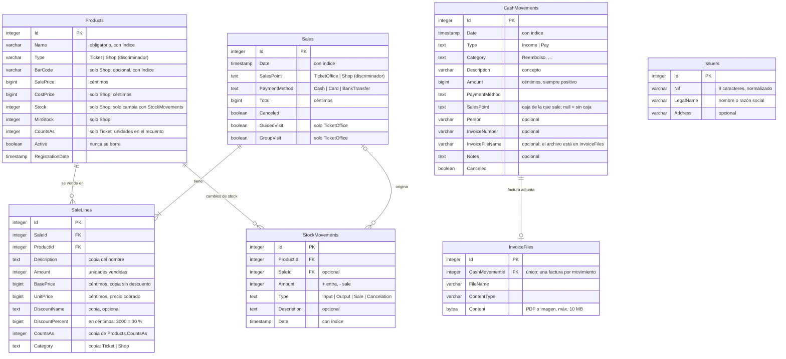

# Base de datos

Esquema de la base PostgreSQL que comparten todos los equipos, tal como lo crean las migraciones
de EF Core (`src/QuickInventory.Data/Migrations`) a partir de `BaseDbContext`.
Si cambias un modelo, añade una migración y actualiza también este documento.

Para ver el esquema real en cualquier momento: `dotnet ef migrations script --project src/QuickInventory.Data --startup-project src/QuickInventory.Data`,
o conectarse con `psql` o cualquier cliente de PostgreSQL (pgAdmin, DBeaver...).

## Diagrama

## Tablas

| Tabla            | Modelo (`QuickInventory.Core/Models`) | Para qué sirve                                                                                           |
| ---------------- | ------------------------------------- | -------------------------------------------------------------------------------------------------------- |
| `Products`       | `Product`                             | Todo lo que se vende: entradas (Taquilla) y artículos (Tienda).                                          |
| `Sales`          | `Sale`                                | Una venta: fecha, punto de venta, método de pago y total.                                                |
| `SaleLines`      | `SalesLine`                           | Cada producto de una venta, con nombre y precios **copiados** del momento de la venta.                   |
| `StockMovements` | `StockMovement`                       | Historial de cada cambio de stock (ajustes, ventas, anulaciones).                                        |
| `CashMovements`  | `CashMovement`                        | Dinero que entra o sale y no es una venta. Hoy solo reembolsos (`Category = "Reembolso"`, `Type = Pay`). |
| `InvoiceFiles`   | `InvoiceFile`                         | Factura escaneada de un `CashMovement`. Tabla aparte para no cargar el archivo al listar.                |
| `Issuers`        | `Issuer`                              | Titular del museo (quien emite las facturas). Una sola fila, creada por el asistente de primera instalación. |
| `__EFMigrationsHistory` | —                              | Migraciones aplicadas. La gestiona EF; la app solo la lee para comprobar la versión.                     |

## Relaciones

- **Sale → SaleLines (1 a muchos).** Una venta tiene al menos una línea (lo exige `SalesService`).
- **Product → SaleLines (1 a muchos).** La línea apunta al producto, pero no depende de él para
  mostrarse: nombre, precios, descuento, categoría y `CountsAs` están copiados, así que editar
  el producto no cambia el histórico.
- **Product → StockMovements (1 a muchos).** `Products.Stock` debe ser siempre la suma de sus movimientos.
- **Sale → StockMovements (0/1 a muchos).** Los movimientos de tipo `Sale` y `Cancelation` apuntan a
  la venta que los originó; los ajustes manuales no tienen venta.
- **CashMovement → InvoiceFile (1 a 0/1).** Índice único en `CashMovementId`.
- `CashMovements.SalesPoint` **no** es una relación: es el enum de la caja (Taquilla/Tienda). Los
  reembolsos en efectivo de una caja se restan al cerrarla.

## Convenciones de almacenamiento

- **Dinero:** todos los `decimal` se guardan como **céntimos enteros** (`AmountInCentsConverter`).
  `12,50 €` → `1250`. Ojo: `DiscountPercent` también es `decimal`, así que `30 %` se guarda como `3000`.
- **Enums:** como texto (`"Cash"`, `"TicketOffice"`...). `ProductCategory` se guarda por su `Value`
  (`"Ticket"`, `"Shop"`).
- **Fechas:** `timestamp without time zone`, con la hora local del museo (`DateTime.Now`).
  Es una convención de `BaseDbContext.ConfigureConventions`.
- **Herencia:** una tabla por jerarquía. `Products.Type` y `Sales.SalesPoint` dicen la clase; las
  columnas de una sola clase (`Stock`, `CountsAs`, `GuidedVisit`...) son null en las filas de la otra.
- **Ids:** columnas `identity` de PostgreSQL.
- **Nada se borra:** productos (`Active`), ventas (`Canceled`) y reembolsos (`Canceled`) se marcan,
  para conservar el historial.
